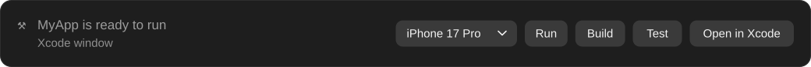
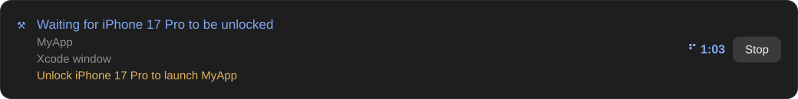
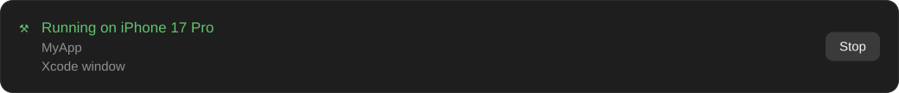
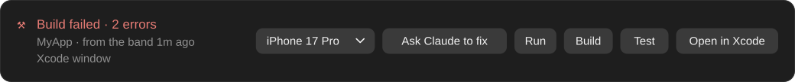
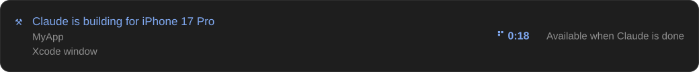
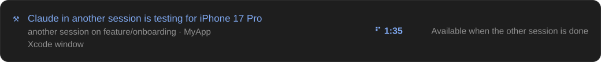
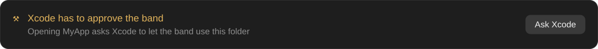

# Xcode Companion

A Claude Code plugin for working on **Xcode projects** with Claude. Its first
part is a band above the prompt: **build, run and test** from there, and see
what is building right now: Claude, Xcode itself, or another Claude Code
session on the same Mac.

It drives Xcode through **Xcode's own MCP server** (`xcrun mcpbridge`, Xcode
26.3 and newer), the same one Claude uses, so the band and Claude never fight
over the project.



## What it looks like

A run waits for a locked iPhone and says what to do:



While the app runs, Stop is the only button:



After a failed build, the errors go to Claude with one press:



While Claude builds, the band waits instead of starting a second build:



Another session on the same checkout is testing, so this one does not build:



Setup goes one step at a time, with the button for that step:



## What you get

- **Run · Build · Test · Open in Xcode** — on the device or simulator picked in
  the band (connected devices first, then simulators, the Mac last). While the
  app runs, **Stop** is the only button; while a run or test from the band is
  under way, Stop ends it.
- **Who is building, live** — Claude (through Xcode's MCP tools or
  `xcodebuild`), the band, Xcode itself (a build you start in the Xcode window),
  or another session. A build started in Xcode shows within about a second.
- **The phase of a run** — building, launching, or **waiting for a locked
  device**: "Unlock *your iPhone* to launch *App*", with a toast.
- **Results that say what happened** — `Build failed · 2 errors`,
  `Tests failed · 2 of 40`, `Launched on …`, `App ended on …`. After a failure the
  band started, **Ask Claude to fix** puts the errors in the prompt (it never
  sends anything by itself).
- **No collisions** — while Claude works, the band waits ("Available when Claude
  is done"). While the band, Xcode or another session on the same checkout
  builds, Claude's own Xcode builds wait for it. A device another session runs on
  cannot be picked for a run.
- **Many sessions, one Mac** — sessions share what they build through a small
  registry, so a second session on the same checkout sees the build and cannot
  start another. A worktree builds in parallel, but not on the same device.
- **Headless or in the Xcode window** — with Xcode 27 the band works with Xcode
  closed (headless). Open the project in Xcode and the band moves to its window,
  so what it builds is what you see there; quit Xcode and it moves back.
- **Guided setup** — the band finds the project and walks you through what is
  missing, one step and one button at a time: Xcode not installed or too old,
  `xcode-select` on the Command Line Tools, Xcode's MCP switched off, Xcode
  needing to be open (26.3), the approval dialog in Xcode, the project to open.
- **`band_state` tool** — Claude can read the band's state (setup step, device,
  what builds, the last result).
- **Commands** — `/xcode-companion-band` shows or hides the band,
  `/xcode-companion-setup` walks through the setup again (the build backend
  included: only Xcode's MCP server today).

Outside an Xcode project the band stays out of the way entirely.

## Install

```
/plugin install xcode-companion --marketplace HenrikSchnettler/xcode-companion
```

Answer `y` to add the marketplace, pick a scope, and open an Xcode project's
folder in Claude Code. The band takes it from there.

For development from a local clone:

```
claude --plugin-dir /path/to/xcode-companion
```

## Requirements

- macOS with **Xcode 26.3 or newer** (`xcrun mcpbridge`). With **Xcode 27** the
  band also works with the Xcode app closed.
- Claude Code with mods (function hooks): the band draws above the prompt in the
  terminal and in the desktop app.
- Xcode asks once to approve Claude Code for the project's folder; the band
  opens that dialog for you.

The plugin brings Xcode's MCP server with it (`xcrun mcpbridge`), so nothing
needs to be registered by hand. If you already registered it yourself, the
same server is used, not a second one. Either way **Claude gets Xcode's tools
too**.

## How it works

Xcode's MCP server only answers questions; it never reports a change by
itself. So the band polls, and keeps that cheap:

| Every | What | How |
|---|---|---|
| 1 s | Is anything building? | Xcode's build service has child processes (`pgrep`, local) |
| when a build starts, then 4 s | Is it this project? | `GetBuildLog` on the project's workspaces |
| 4 s | Does the app run? Other sessions? | `GetConsoleOutput`; the shared registry |
| 8 s | Xcode window opened or closed? | `XcodeListWorkspaces` |
| 16 s | Devices plugged in or out? | `XcodeListRunDestinations` |
| 2 s, during a run | Building, launching, locked? | the build service; `devicectl … lockState` |

Before every Run, Build or Test the band checks again, fresh, so an old picture
never starts anything. After **10 idle minutes** it stops polling until you are
back (a prompt, a press in the band, the session reopened).

Xcode writes a file for many of its answers (a whole build log for
`GetBuildLog`) and never removes it; the band removes the ones its own calls
leave.

## Layout

```
.claude-plugin/plugin.json      # manifest; ships Xcode's MCP server (xcrun mcpbridge)
.claude-plugin/marketplace.json # makes this repository its own marketplace
hooks/hooks.json                # registers the hooks module
hooks/register.tsx              # the band: polling, actions, setup, other sessions
hooks/model.ts                  # what the band shows and allows, as pure functions
types/index.d.ts                # the mod's state contract
tests/band.test.ts              # the band, driven through the engine
```

## Surface support and known issues

- **Terminal**: everything works in every permission mode.
- **Desktop app, auto mode**: the app refuses a mod's own MCP calls
  ([anthropics/claude-code#101884](https://github.com/anthropics/claude-code/issues/101884)),
  though the plugin API says they need no permission. The band says so and
  points to the issue. Use another mode, or the terminal.
- **Desktop app, manual mode**: the app asks for permission on the band's own
  MCP calls, polling included. Allow the read-only ones
  (`GetConsoleOutput`, `XcodeListWorkspaces`, `XcodeListRunDestinations`,
  `GetBuildLog`), or use another mode or the terminal.
- Cloud and remote sessions don't load plugins.

## What it touches on your Mac

- Runs `pgrep`, `xcodebuild -version`, `xcrun` (`mcp-server status`,
  `devicectl … lockState`), `git rev-parse` and `open` (Xcode, the App Store).
- Writes one small file per running build to `~/.claude/xcode-companion/busy/`
  and removes it when the build ends (stale ones are cleaned up by any session).
- Removes the files Xcode writes for the band's own MCP calls, and only those,
  under Xcode's `ActionArtifacts` temporary folder.
- Opens and closes the project in Xcode's headless server. It opens an Xcode
  window only when you press **Open in Xcode**, and never closes one.

## Tests

```
claude plugin validate .
claude plugin test .
```

## License

MIT
